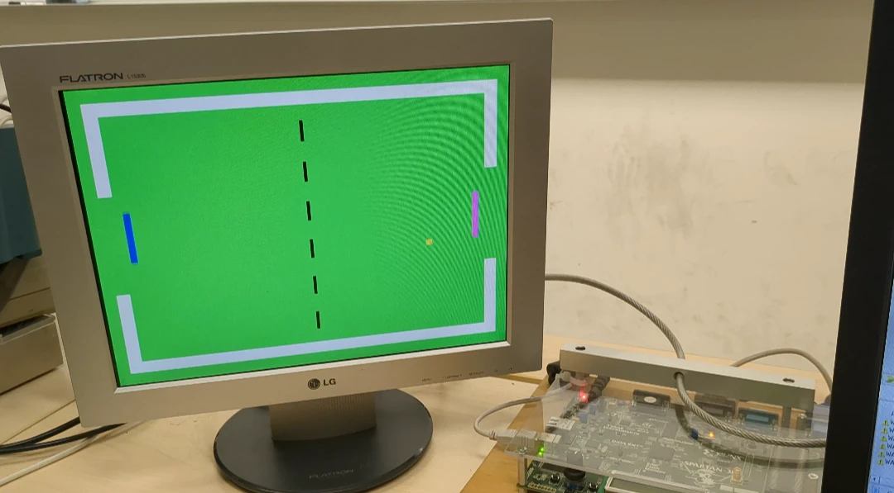
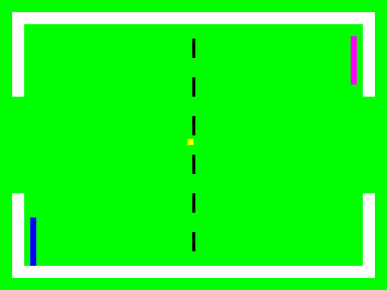
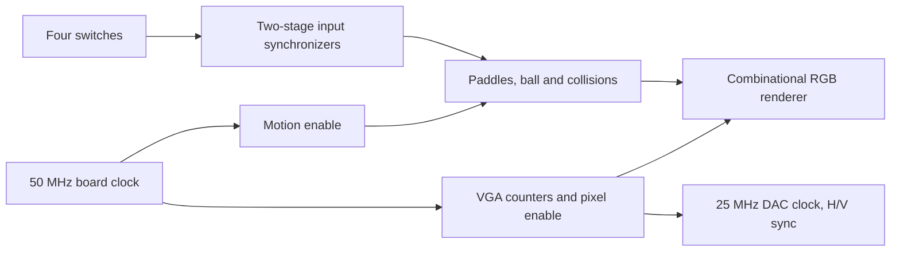

# FPGA VGA Pong

A two-player VHDL Pong game with a 640×480 VGA image, hardware switch controls,
paddle and wall collisions, and ball reset after a goal. Built for COE758 (Digital
Systems Engineering, fall 2024) on a Spartan-3E XC3S500E with the lab's video DAC.
The October 2026 refresh makes the design portable to simulation and verifies its
video and game behavior.

## Board demo



**Historical 2024 board execution.** This photograph was extracted from my final
project report; it shows the original submitted design. It is not a new board run
of the refreshed RTL. The archived implementation reports 782 slices and 1,483
four-input LUTs; its timing report had no timing constraints, so those reports
do not establish timing closure for the refresh.

## 2026 RTL simulation



This frame is produced by sampling the actual VHDL RGB outputs in `tb_video`,
with motion disabled for the capture. No JavaScript reimplementation is used.

https://github.com/user-attachments/assets/a3c2dd1b-a141-4e0d-a551-43696cea86e1

Fifteen seconds of gameplay: 900 consecutive
frames sampled from the same RGB outputs by `tests/tb_record.vhd`, at 60 Hz and the
board's motion rate. Scripted switch inputs track the ball using only the video;
the right player parks for one rally to show a goal and reset. This is RTL
simulation, not a new board run. Convert the recording with
[`scripts/render-gameplay.py`](scripts/render-gameplay.py).

## Run the checks

Requires GHDL 5.1.1 (or compatible) and Bash:

```sh
bash scripts/check.sh
```

Or run the pinned GHDL image with Docker, without installing an EDA tool locally:

```sh
bash scripts/check-docker.sh
```

The checks cover:

- The archived simulation discrepancy: a border scanline must contain 600 white pixels.
- A complete 800×525 frame, 640×480 active pixels, horizontal/vertical sync pulses
  and porches, black blanking, known object colors, frame wrap, and 40 ns DAC period.
- Motion enable, paddle bounds and pause controls, reset, paddle/wall collisions
  and goal reset through 10,000 motion updates.
- GHDL synthesis elaboration of the top-level RTL. This is not device synthesis,
  placement/routing or board timing closure. GHDL warns that it ignores the
  vendor-specific `ASYNC_REG` attribute; the synchronizer registers remain present.

[Retained check output](docs/evidence/verification-2026-10-04.log) ·
[Refresh and hardware limits](docs/verification.md)

## Design



All internal registers use the board clock. Pixel and motion updates use clock
enables; the divided DAC clock is an output, not an internal fabric clock. Pixel
coordinates advance on the DAC falling phase so RGB can settle before its rising
edge. Video uses 800 pixels × 525 lines, with 96-pixel horizontal and two-line
vertical active-low sync. A 25 MHz pixel rate gives approximately 59.52 Hz frames;
this preserves the historical 50 MHz / 2 lab clock, rather than claiming 25.175 MHz.

`SW0`/`SW2` choose each paddle's direction (`1` up, `0` down); `SW1`/`SW3` pause
their respective paddles (`1` paused). Two-stage synchronizers handle asynchronous
switch inputs. Mechanical debouncing is not implemented. FPGA register initialization
starts the game; the isolated game module also exposes a reset for verification.

## Hardware build

For the historical ISE target, add `rtl/vga_timing.vhd`, `rtl/pong_game.vhd` and
`rtl/pong.vhd`, select `pong` as top, and use `rtl/constraints.ucf`. It preserves
the recovered lab pin mapping and adds a 20 ns input-clock constraint. Device is
XC3S500E, FG320 package, historical speed grade -5. Check your actual board and DAC
connections before programming; this pinout is not a universal VGA connector mapping.

`rtl/timing.sdc` documents the input and DAC clocks for an eventual port. It is not
a complete device-specific constraint set. DAC setup/hold, output delays and input
synchronizer timing still need the actual hardware budget. No refreshed ISE bitstream
or place-and-route result is claimed. The original archival bitstream remains in
the private school archive rather than being offered as a build of this source.

`archive/` preserves the submitted `pong.vhd` and original UCF.
[Provenance](docs/provenance.md) records the origin and independent refresh.
